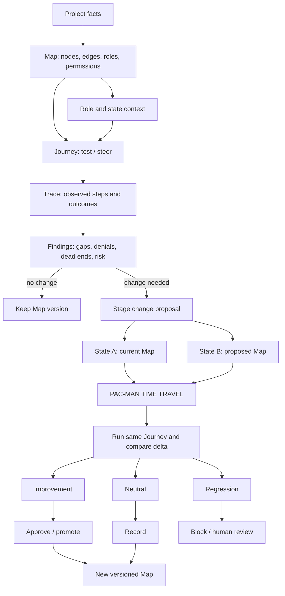

# Project Map Flow

> the map is the facts. the journey is the test / steer.

This is the current visual and executable shape of Project Map. The CLI diagram is generated by:

```bash
python3 tools/project_map_flow.py
```

## Mermaid version



## Pseudocode

```text
function project_map_run(map, journey):
    validate(map)
    validate(journey)

    state = journey.initial
    trace = new Trace(
        map_version = map.version,
        journey_id = journey.id,
        start_state = state
    )

    for step in journey.steps:
        result = execute(step, map, state)
        trace.record(step, result)

        if result.changes_state:
            state = result.next_state

        if result.is_unexpected:
            trace.add_finding(
                kind = classify(result),
                step = step,
                evidence = result
            )

    return trace


function pac_man_time_travel(current_map, proposal, journeys):
    state_a = snapshot(current_map)
    state_b = apply_proposal_to_clone(current_map, proposal)

    if state_b.is_invalid:
        return BLOCK(proposal, reason = state_b.validation_errors)

    before = []
    after = []

    for journey in journeys:
        before.append(project_map_run(state_a, journey))
        after.append(project_map_run(state_b, journey))

    delta = compare(
        before,
        after,
        compare = [
            reachable_nodes,
            allowed_capabilities,
            permission_changes,
            trace_events,
            findings
        ]
    )

    classification = classify_delta(delta)

    if classification.contains_critical_security_regression:
        return HARD_BLOCK(delta)

    if classification.contains_notable_regression:
        return HUMAN_REVIEW(delta)

    if classification.is_improvement:
        return APPROVAL_READY(delta)

    return RECORD_AS_NEUTRAL(delta)
```

## Current implementation boundary

Already working:

- declarative Map
- declarative Journey
- role permission checks
- allowed and denied traversal
- Trace JSON
- CLI flow diagram

Not yet implemented:

- schema validation command
- formal Trace and Finding schemas
- live MindWaveMine adapter
- graph visualizer
- change proposal engine
- before/after comparison
- full Pac-Man time travel

The diagram is therefore a **visual contract for the route**, not a claim that every box is already operational.
